# Servo V2 comparisons

Generated by `python make_servo_comparison.py`.

Ten editable clearance references: four standard and six micro.
[Numerical comparison](servo_profiles.csv) | [Block dimensions](assemblies.json)

Screw values are clearance envelopes; read the evidence column before selecting hardware.

Axial coordinates use the installed holder datum: standard includes its default 1 mm ear spacers; micro uses no ear spacers. Raw research JSON retains the nominal ear datum.

## comparison standard micro

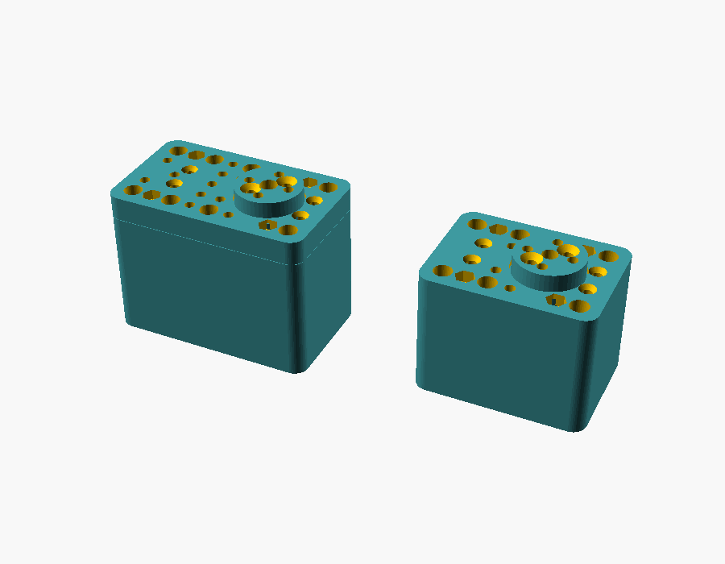

[SCAD](../../parts/oobb_part_holder_motor_servo_micro_4_width_3_height_14d2_depth_bearing_6704_version2/comparison_standard_micro.scad) | [STL](../../parts/oobb_part_holder_motor_servo_micro_4_width_3_height_14d2_depth_bearing_6704_version2/comparison_standard_micro.stl)

## comparison standard micro sections

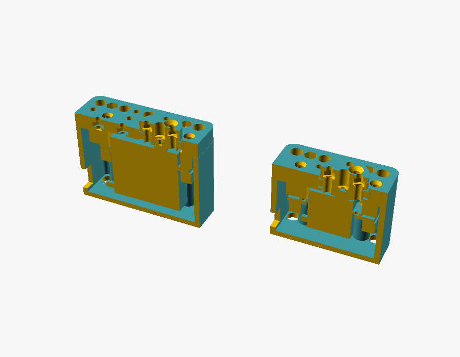

[SCAD](../../parts/oobb_part_holder_motor_servo_micro_4_width_3_height_14d2_depth_bearing_6704_version2/comparison_standard_micro_sections.scad) | [STL](../../parts/oobb_part_holder_motor_servo_micro_4_width_3_height_14d2_depth_bearing_6704_version2/comparison_standard_micro_sections.stl)

## comparison socket sections

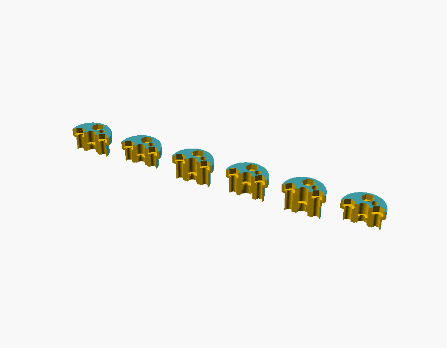

[SCAD](../../parts/oobb_part_holder_motor_servo_micro_4_width_3_height_14d2_depth_bearing_6704_version2/comparison_socket_sections.scad) | [STL](../../parts/oobb_part_holder_motor_servo_micro_4_width_3_height_14d2_depth_bearing_6704_version2/comparison_socket_sections.stl)

## comparison retention screws

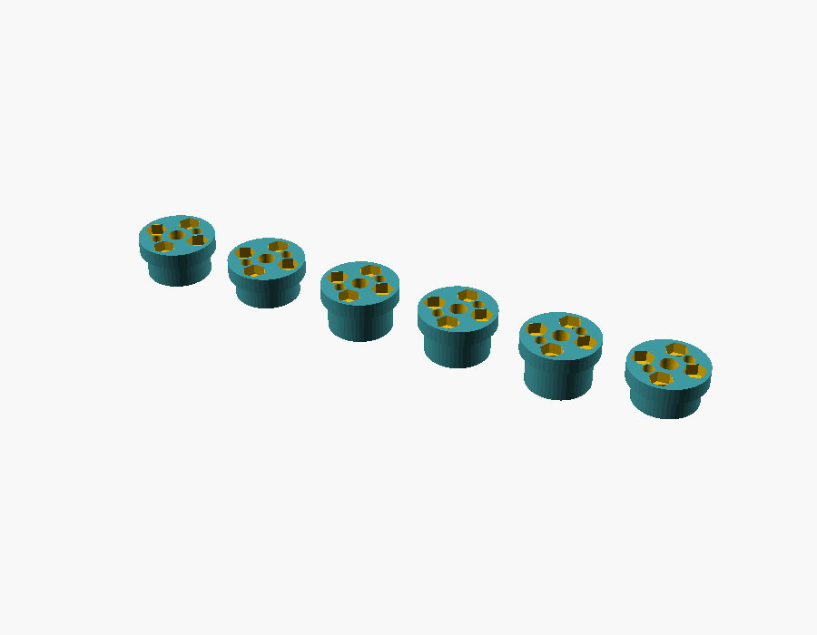

[SCAD](../../parts/oobb_part_holder_motor_servo_micro_4_width_3_height_14d2_depth_bearing_6704_version2/comparison_retention_screws.scad) | [STL](../../parts/oobb_part_holder_motor_servo_micro_4_width_3_height_14d2_depth_bearing_6704_version2/comparison_retention_screws.stl)

## comparison servo envelopes

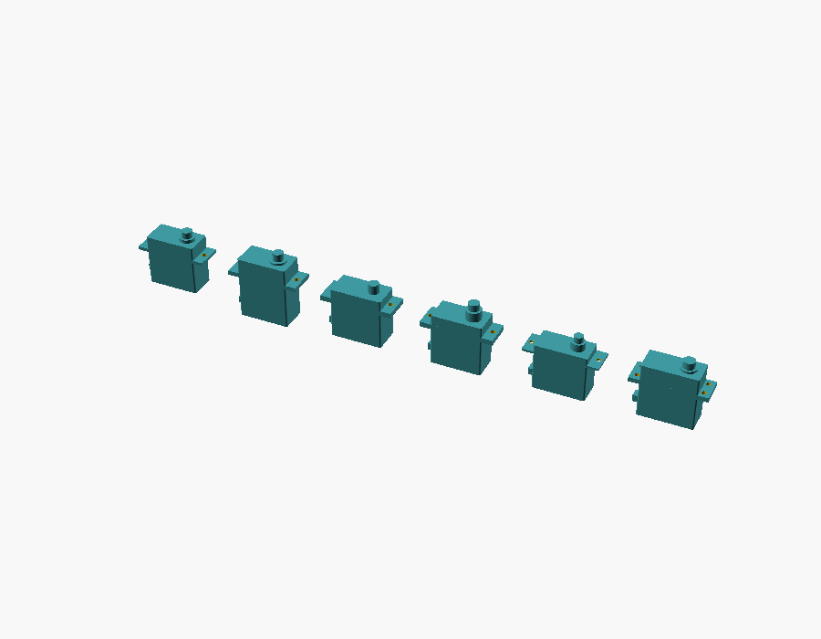

[SCAD](../../parts/oobb_part_holder_motor_servo_micro_4_width_3_height_14d2_depth_bearing_6704_version2/comparison_servo_envelopes.scad) | [STL](../../parts/oobb_part_holder_motor_servo_micro_4_width_3_height_14d2_depth_bearing_6704_version2/comparison_servo_envelopes.stl)

## comparison mount patterns

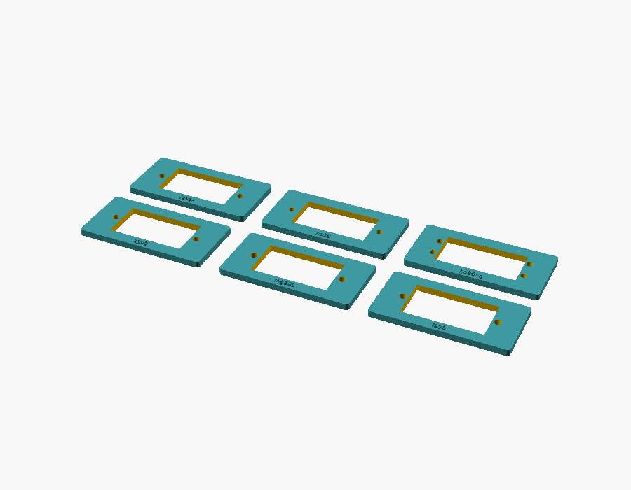

[SCAD](../../parts/oobb_part_holder_motor_servo_micro_4_width_3_height_14d2_depth_bearing_6704_version2/comparison_mount_patterns.scad) | [STL](../../parts/oobb_part_holder_motor_servo_micro_4_width_3_height_14d2_depth_bearing_6704_version2/comparison_mount_patterns.stl)

## comparison rotor profiles

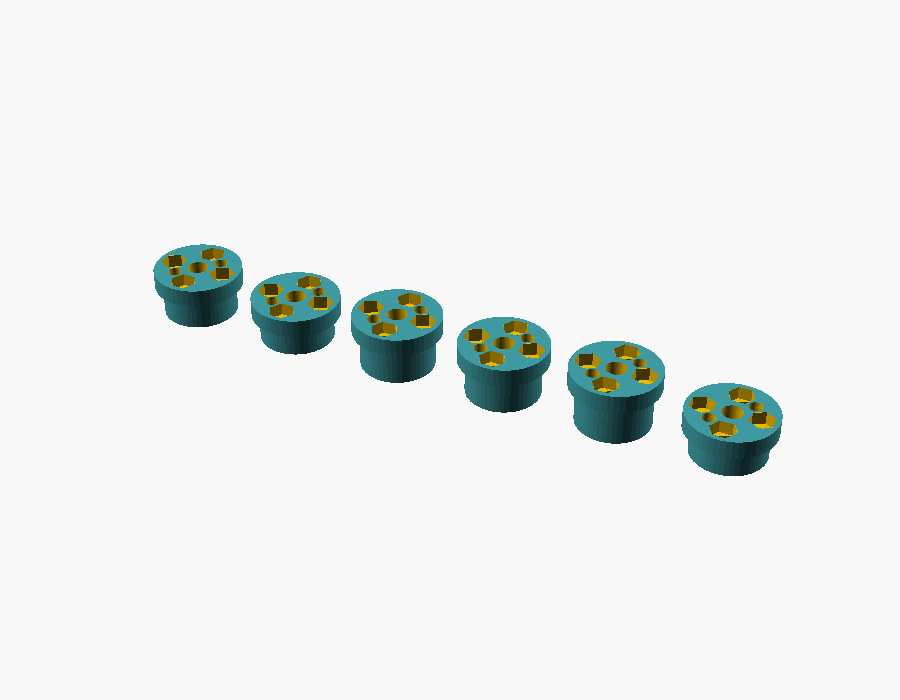

[SCAD](../../parts/oobb_part_holder_motor_servo_micro_4_width_3_height_14d2_depth_bearing_6704_version2/comparison_rotor_profiles.scad) | [STL](../../parts/oobb_part_holder_motor_servo_micro_4_width_3_height_14d2_depth_bearing_6704_version2/comparison_rotor_profiles.stl)

## 3dpr

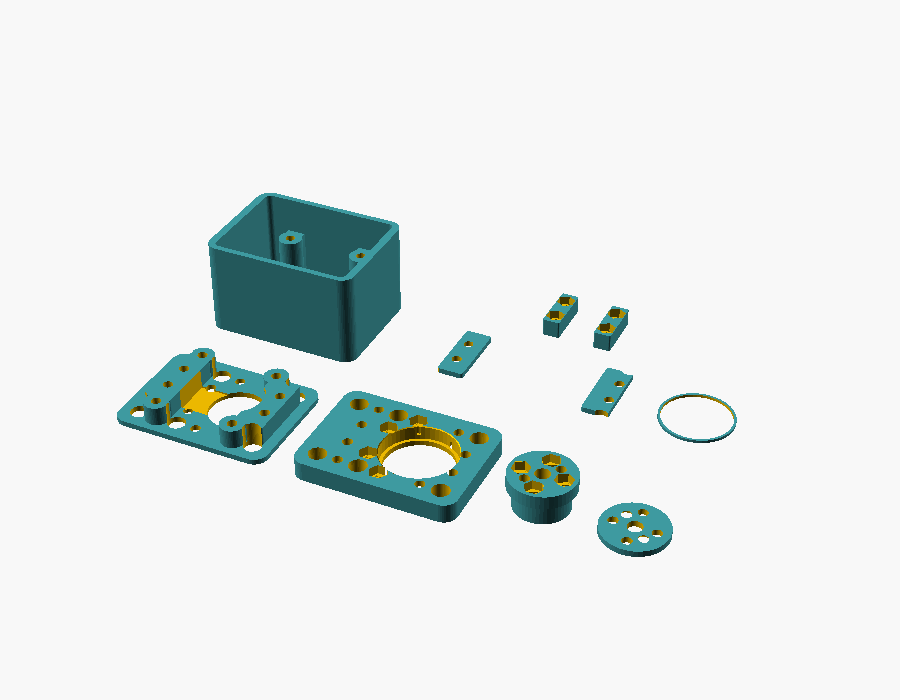

[SCAD](../../parts/oobb_part_holder_motor_servo_micro_4_width_3_height_14d2_depth_bearing_6704_version2/3dpr.scad) | [STL](../../parts/oobb_part_holder_motor_servo_micro_4_width_3_height_14d2_depth_bearing_6704_version2/3dpr.stl)

## horn fit test

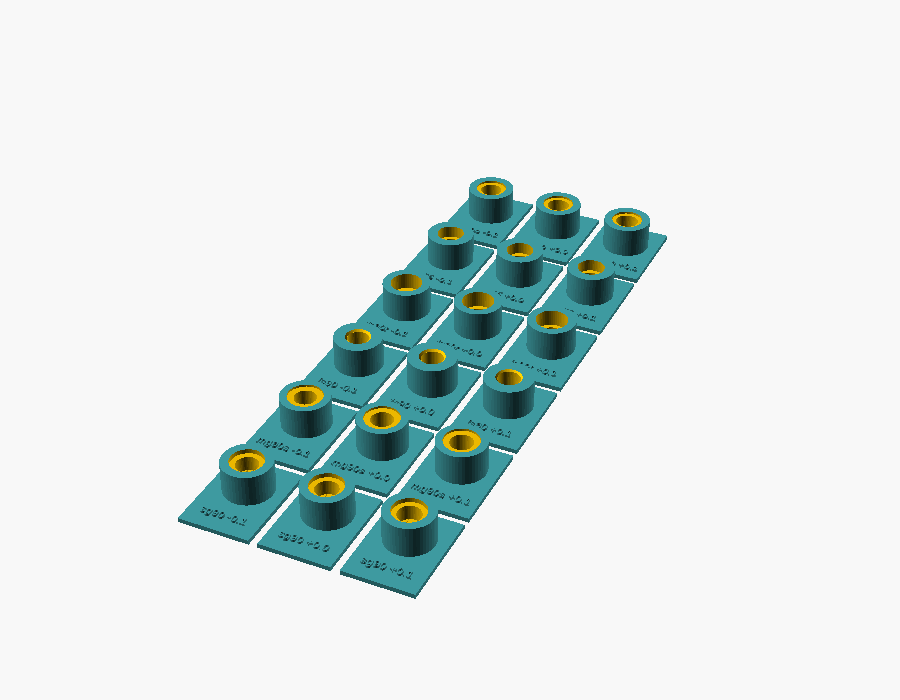

[SCAD](../../parts/oobb_part_holder_motor_servo_micro_4_width_3_height_14d2_depth_bearing_6704_version2/horn_fit_test.scad) | [STL](../../parts/oobb_part_holder_motor_servo_micro_4_width_3_height_14d2_depth_bearing_6704_version2/horn_fit_test.stl)

## bearing fit test

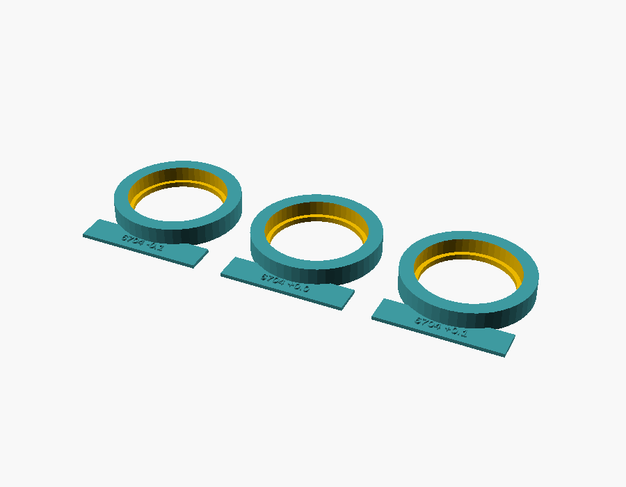

[SCAD](../../parts/oobb_part_holder_motor_servo_micro_4_width_3_height_14d2_depth_bearing_6704_version2/bearing_fit_test.scad) | [STL](../../parts/oobb_part_holder_motor_servo_micro_4_width_3_height_14d2_depth_bearing_6704_version2/bearing_fit_test.stl)

## retention bore test

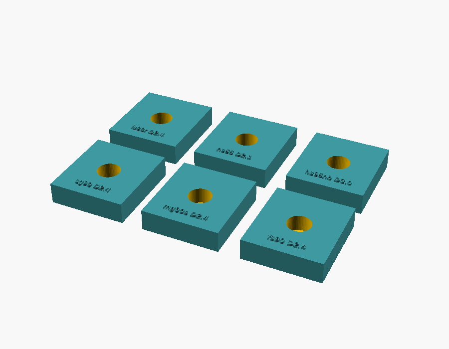

[SCAD](../../parts/oobb_part_holder_motor_servo_micro_4_width_3_height_14d2_depth_bearing_6704_version2/retention_bore_test.scad) | [STL](../../parts/oobb_part_holder_motor_servo_micro_4_width_3_height_14d2_depth_bearing_6704_version2/retention_bore_test.stl)

